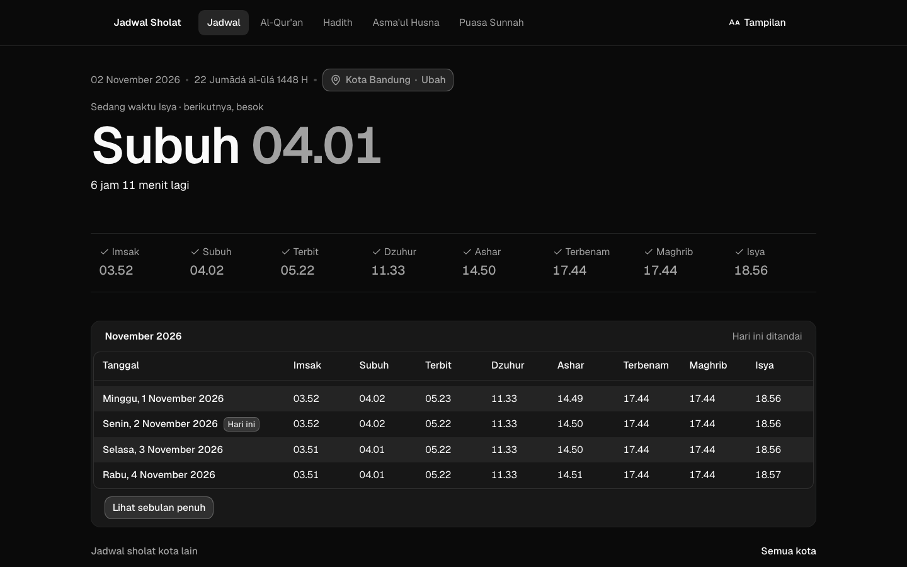
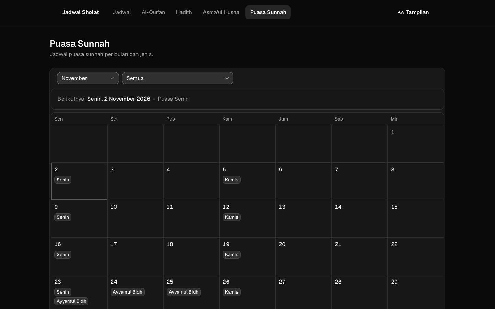
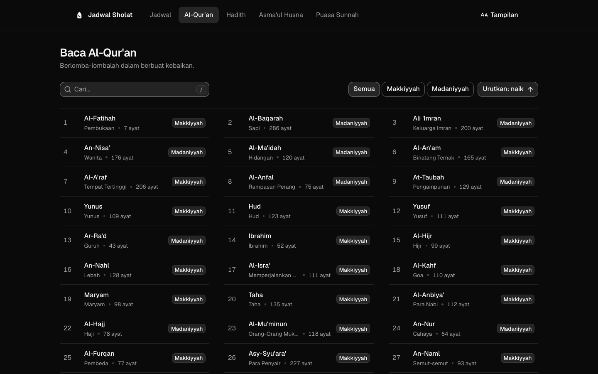
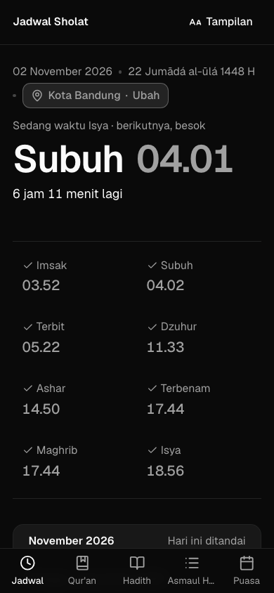
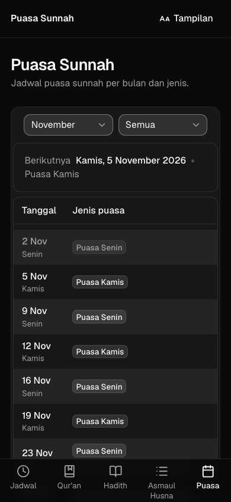
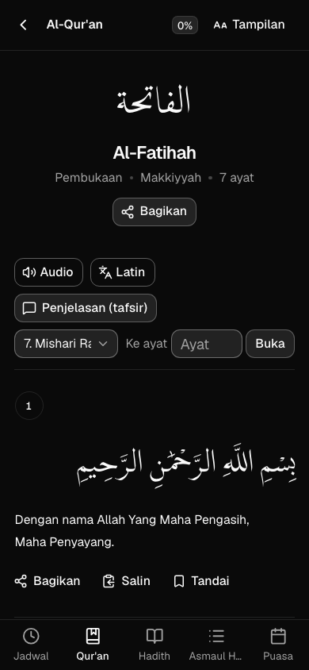

<div align="center">
  
  <h1>Jadwal Sholat</h1>
  <p>Prayer times, Al-Qur'an, hadith, Asma'ul Husna and sunnah fasting, on the web and Android.</p>
  <p><a href="https://jdwshlt.ekel.dev">Open the website</a></p>
</div>

## Features

- Today's prayer times for your location, a countdown to the next prayer, the Hijri date and the full month, plus schedules for 51 Indonesian cities
- Adzan reminders: browser notifications on the web, alarms that ring with the app closed on Android
- Al-Qur'an with audio from several reciters, transliteration, translation and tafsir, plus pages for well-known ayat such as Ayat Kursi
- Hadith by book and number, the 99 names of Allah, and sunnah fasting days from the [Puasa Sunnah API](https://puasasunnah.ekel.dev/swagger/index.html)
- Share a surah, an ayah or a hadith, and see the last loaded schedule offline
- Made for every age: adjustable text and Arabic sizes, light and dark themes, keyboard and screen reader support (targets WCAG 2.2 AA)

## Screenshots

| Prayer schedule | Sunnah fasting | Al-Qur'an library |
| :---: | :---: | :---: |
|  |  |  |

| Prayer schedule | Sunnah fasting | Al-Qur'an reading |
| :---: | :---: | :---: |
|  |  |  |

## Tech

The website is [Astro](https://astro.build) 7 with React islands, served as static files from Cloudflare Pages, styled with Tailwind CSS v4, shadcn/ui and [ReUI](https://reui.io). The Android app uses Expo, NativeWind and [React Native Reusables](https://reactnativereusables.com). Both share the code in `packages/core`. The monorepo runs on Bun and [moon](https://moonrepo.dev).

## Getting started

You need [Bun](https://bun.sh), [Node.js](https://nodejs.org) 22.23.4 or later, and [moon](https://moonrepo.dev) (also installed in the workspace as `@moonrepo/cli`).

```bash
git clone https://github.com/haikelz/jadwal-sholat.git
cd jadwal-sholat
bun install
cp apps/web/.env.example apps/web/.env   # then fill in the API URLs
bun run dev:web                          # http://localhost:4321
```

| Command | What it does |
| --- | --- |
| `bun run dev:web` | Website dev server |
| `bun run build:web` | Static website build in `apps/web/dist` |
| `bun run test:web` | Cypress tests, with `bun run preview` running in `apps/web` |
| `bun run test:core` | Unit tests for `packages/core` |
| `bun run dev:mobile` | Android app dev server for Expo Go or a development build |
| `bun run build:android` | Preview APK on EAS |

Hadith detail pages and the sunnah fasting schedule need Cloudflare's `_redirects` and `_worker.js`, which `astro dev` and `astro preview` skip. To try them locally, build the site and run `bunx wrangler pages dev dist` in `apps/web`.

## Deploy

### Website on Cloudflare Pages

| Setting | Value |
| --- | --- |
| Root directory | `apps/web` |
| Build command | `cd ../.. && bun install --frozen-lockfile && cd apps/web && bun run build` |
| Build output directory | `dist` |
| Build variables | `SKIP_DEPENDENCY_INSTALL=1`, `BUN_VERSION=1.4.4`, `NODE_VERSION=24` |
| API URLs | `ASMAUL_HUSNA_API`, `HADITH_API`, `JADWAL_SHOLAT_API`, `NOMINATIM_API`, `QURAN_API` and `PUASA_SUNNAH_API`, as in `apps/web/.env.example` |
| Optional | `GOATCOUNTER_URL` (the GoatCounter `…/count` endpoint), `PUBLIC_SENTRY_DSN`, and `SENTRY_AUTH_TOKEN`, `SENTRY_ORG`, `SENTRY_PROJECT` to upload source maps |
| Build watch paths | `apps/web/*`, `packages/core/*`, `bun.lock` |

CI (`.github/workflows/main.yaml`) runs the core tests and the type checks on every push to `master` and every pull request. It reads `ASMAUL_HUSNA_API`, `HADITH_API`, `JADWAL_SHOLAT_API`, `NOMINATIM_API` and `QURAN_API` from the repository variables (Settings → Secrets and variables → Actions → Variables).

### Android app

Copy `apps/mobile/.env.example` to `apps/mobile/.env`, fill in the API URLs, and send them to EAS once from `apps/mobile`:

```bash
bunx eas-cli env:push --environment development --environment preview --environment production --path .env
```

`bun run dev:mobile` previews the app in [Expo Go](https://expo.dev/go). Adzan sounds and background tasks need a development build: `bunx eas-cli build --platform android --profile development`. Native code compiles on EAS, so you don't need Android Studio.

## Project layout

| Path | Contents |
| --- | --- |
| `apps/web` | The website |
| `apps/mobile` | The Android app |
| `packages/core` | Code both apps share: API schemas, prayer times, the adzan schedule, dates and bundled data |
| `packages/typescript-config` | Shared TypeScript configs |

Contributor rules are in [`AGENTS.md`](AGENTS.md) and the design rules in [`apps/web/DESIGN.md`](apps/web/DESIGN.md).

## Activity


## Support

- [GitHub Sponsors](https://github.com/sponsors/haikelz)
- [Trakteer](https://trakteer.id/haikelz/tip)

Inspired by [islamiah.vercel.app](https://islamiah.vercel.app/). Released under the MIT license.
